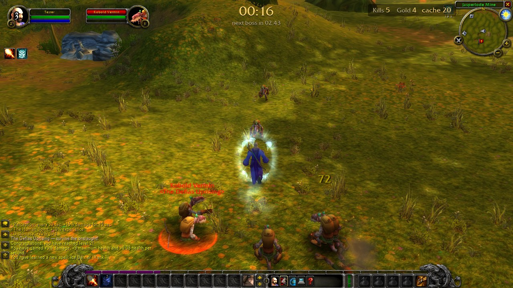
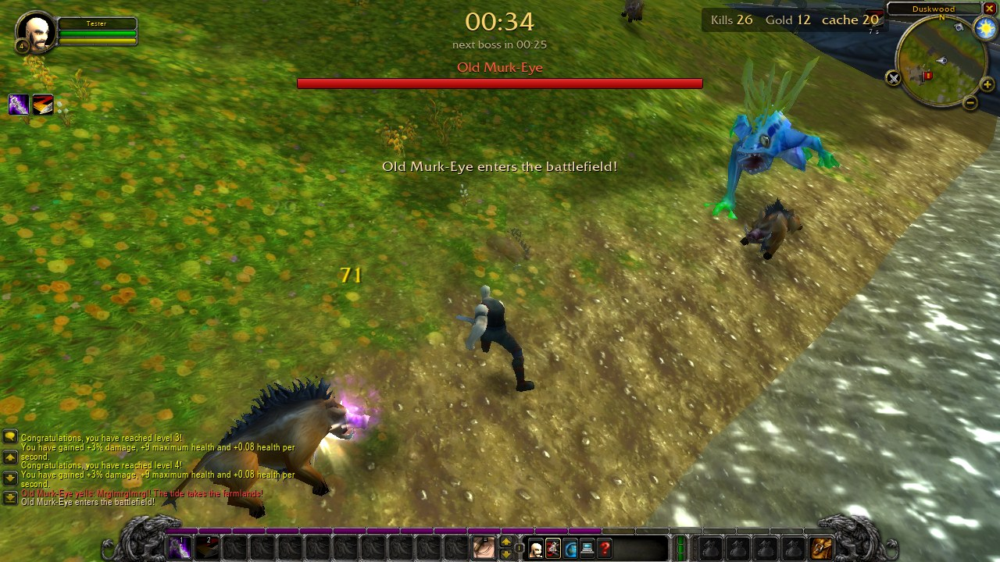
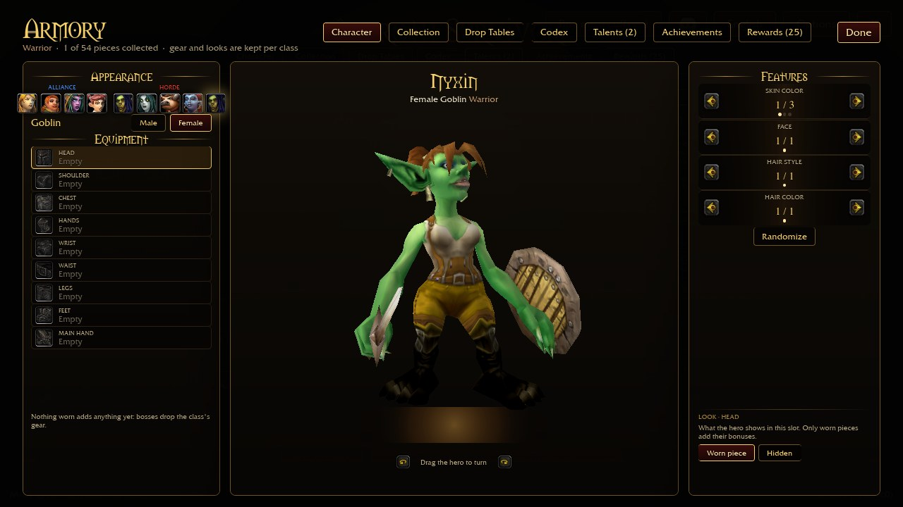
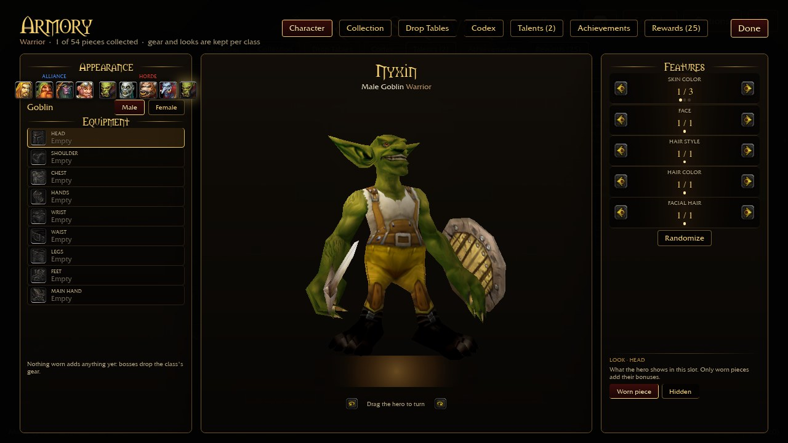
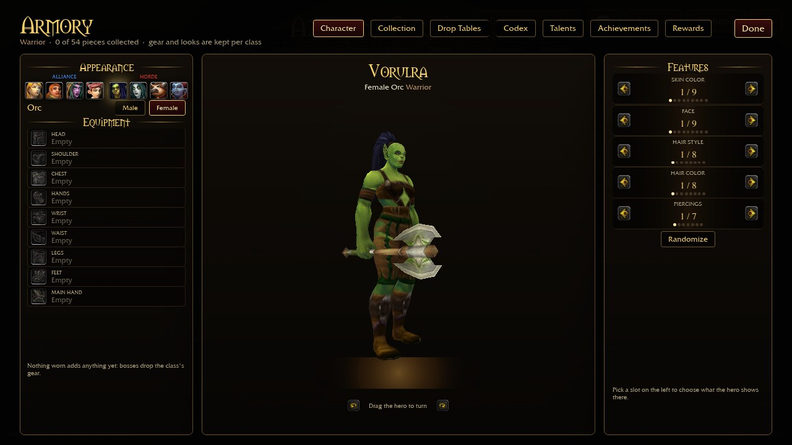
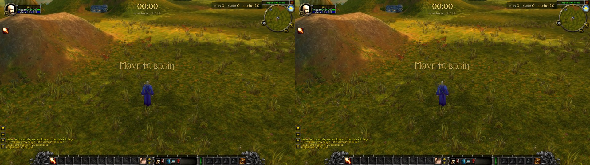

# Azeroth Survivors Overhaul

[](https://ko-fi.com/finalpantasy)

Recipes, installer and converters that upgrade the **Windows build of Azeroth Survivors** (the survivor-like built on
World of Warcraft art) with higher-resolution models and textures built **from your own WoW install**, plus new races,
zones, bosses and gear.

> Bring your own game. This repository contains **code, recipes (hashes and instructions) and documentation only**.
> It ships no Blizzard assets, no community HD files, no game executable and no patched executable or archives.

## What it does

* **HD from your own WoW Retail / Forever install.** Converters read your installed WoW client and build model and
  texture overlays for the game, so the result is made on your machine. Each package is optional and installed separately:
    * skinned character and creature models (`tools/skinned-converter`)
    * rigid items and gear (`tools/asset-coverage`, `tools/retail-rigid-preview`, `tools/retail-item-equip`)
    * character, face, hair and armor tools (`tools/characters`)
    * world terrain/doodad overlays and spell effects (`tools/world`, `tools/spells`)
    * a renderer pass (sharpening, rim light, fog) (`tools/renderer-upgrade`)
* **New content:** new playable races (Goblin first, `tools/new-races`), new zones, bosses and gear sets
  (`tools/content`).
* **A transactional installer** (`tools/installer`): plan first, verified backups, a receipt for every change, and one-command
  rollback. Saves and config are hashed before and after and must not change.

## Screenshots

These are frames from automated runs of local preview builds (1280x720). They show the result of the packages above.

| | |
|---|---|
|  |  |
|  |  |
|  |  |

## Requirements

* Windows 10/11 and Python 3 (tested on 3.14). The installer uses the standard library only.
* A legitimate copy of **Azeroth Survivors for Windows** (the folder that holds `AzerothSurvivors.exe`). Tested against v0.103.x.
* For HD packages: your own **World of Warcraft** client install (the build named in each recipe) and the offline CASC
  reader library, which you build or supply yourself (the installer checks its SHA-256 before loading it).
* Community HD packages need files you obtain yourself; the installer verifies every byte against the recipe.

## Install and roll back

```
cd tools/installer
python as_installer.py detect   --game-root <your game folder> --client-root <your WoW folder>
python as_installer.py recipes
python as_installer.py plan     --game-root <game> --client-root <wow> --casc-dll <CascLib.dll>   # changes nothing
python as_installer.py apply    --game-root <game> --client-root <wow> --casc-dll <CascLib.dll> --yes
python as_installer.py status   --game-root <game>
python as_installer.py rollback --game-root <game> --yes
```

1. Close the game. Run `plan` and read every blocker and hint.
2. `apply` builds in a work folder, verifies, backs up every file it touches, then installs in one transaction.
3. `rollback --yes` restores the backups; it refuses if a file changed since (so it never overwrites your own edits).

See `tools/installer/README.md` and `tools/installer/RECIPES.md` for the full command list and safety model.
Developer scripts under `tools/*` expect a workspace folder (game files at the root, `tools/` beside them, outputs in
`analysis/` and `previews/`); the installer is the supported entry point.

## Credits and legal

* **Azeroth Survivors** is the game by Aethus (online version: wow.aethus.pl; source repo: OutThisLife/azeroth-survivors-re).
  This project is unofficial and not affiliated with its author.
* **wenilla**: the engine/save naming used by the game (`wenilla-rogue`).
* **VanillaHD** community HD pack: used only as an optional, user-supplied input. It carries **no license**, so it is not
  included or redistributed here; users obtain it themselves.
* World of Warcraft and its art are the property of Blizzard Entertainment. Screenshots show game rendering from local
  lab runs; no Blizzard assets are included. Third-party code notices: `tools/distribution/THIRD_PARTY_NOTICES.txt`.
* Code and documentation here: MIT, copyright finalpantasy (see `LICENSE`). The license covers only this repository's code, recipes and docs. Game files, World of Warcraft assets and community packs are NOT covered by it and are NOT included.

## Support

If this saved you time, you can support the work on [Ko-fi](https://ko-fi.com/finalpantasy). Entirely optional.
